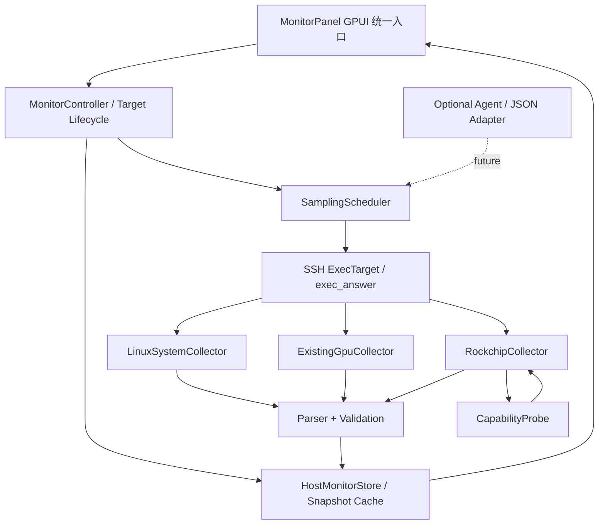
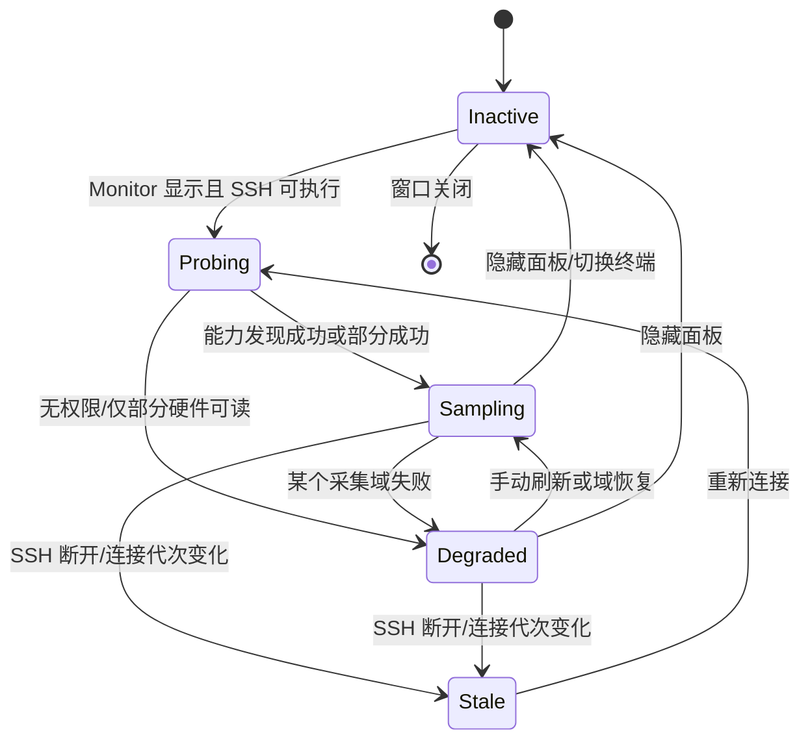

# ShellRS 统一资源监控系统融合设计方案

> **文档版本**：v1.0  
> **编写日期**：2026-10-23  
> **设计状态**：方案评审稿，尚未修改 ShellRS 源码或完成真实板卡联调  
> **目标项目**：[since2006/shell-rs](https://github.com/since2006/shell-rs)  
> **目标平台**：ShellRS 桌面客户端（macOS / Linux / Windows）；远程 Linux 主机（普通服务器、NVIDIA / Ascend 算力设备、Rockchip RK3588 / RK3568 / RK3576 等）  
> **推荐方案**：单一 Monitor 入口、分层数据模型、按能力展示、SSH 直采优先、独立 Agent 可选

---

## 0. 执行摘要与决策

### 0.1 核心结论

将 ShellRS 现有 `Monitor`（CPU、内存、网络、磁盘）与 `GPU/NPU`（NVIDIA、Ascend）合并为**一个统一资源监控入口**，随后通过独立 Rockchip 采集器支持 `RGA / RKNN NPU / MPP(VPU) / Mali GPU`，并逐步引入 `PSI / DMA-BUF / 进程关联 / 异常事件 / 性能诊断`。

**UI 统一不等于数据模型扁平化。** 通用系统指标、通用计算加速器、图像处理器、编解码器需要分别建模，然后组合到主机快照中；采集调度和错误状态应相互隔离。

### 0.2 本版本推荐采纳的架构决策

| 编号 | 决策 | 说明 |
|---|---|---|
| ADR-001 | 单一 `Monitor` 工具入口 | 普通服务器与 Rockchip 共用面板；不新增长期存在的 Rockchip 独立入口 |
| ADR-002 | 采集器与 UI 分离 | `MonitorPanel` 只组织布局和交互；控制器管理采样生命周期及数据 |
| ADR-003 | 保留原有解析实现 | 第一阶段不重写 `monitor/linux.rs` 和 `gpu/linux.rs`，优先封装 |
| ADR-004 | 能力驱动显示 | 依据可读取的接口与检测结果决定展示，不以 SoC 名字硬编码 UI |
| ADR-005 | SSH 无 Agent 首发 | 复用当前终端 SSH 连接；不增加服务端部署要求 |
| ADR-006 | 多周期、非重叠采样 | 每采集域独立周期与超时，同域请求绝不重叠堆积 |
| ADR-007 | 失败不当作 0% | `Unsupported / PermissionDenied / Timeout / Failed / Stale` 必须可区分 |
| ADR-008 | 旧 `gpu` 工具键兼容迁移 | 保留解析旧配置的能力，统一新 UI 到 `monitor` |
| ADR-009 | 写操作与诊断操作分离 | 常规监控只读；`load_interval` 等内核参数绝不静默修改 |
| ADR-010 | Agent/MCP 作为二期可选后端 | 不把独立采集服务设为第一阶段前提 |

### 0.3 交付边界

- **本次文档**：接口方案、模块映射、UI、采样、安全、状态、兼容、测试及落地顺序。
- **不代表已完成**：代码迁移、GPUI 运行测试、Rockchip BSP 兼容验证、板端负载实测。
- **第一版本不做**：Prometheus 时序服务、跨上百台机器集中监控、自动修改内核频率、完整 eBPF 追踪、对每个业务进程推算 NPU 精确使用率。

---

## 1. 背景与现状

### 1.1 当前 ShellRS 的客观结构

以下路径已对照 2026-10-23 可访问的上游 `main` 文件核查。实施前必须在自己的 Fork 上固定提交 SHA，重新确认路径及 API 是否变化。

| 源码位置 | 现有职责 | 本次处理方式 |
|---|---|---|
| [`src/monitor/mod.rs`](https://github.com/since2006/shell-rs/blob/main/src/monitor/mod.rs) | Monitor 子模块与折叠项声明 | 扩展统一监控入口 |
| [`src/monitor/model.rs`](https://github.com/since2006/shell-rs/blob/main/src/monitor/model.rs) | CPU/内存/网络/磁盘 Reading、Snapshot、差分计算 | 保留已验证的算法；增加组合快照层 |
| [`src/monitor/linux.rs`](https://github.com/since2006/shell-rs/blob/main/src/monitor/linux.rs) | 通过单条 shell 命令读取 procfs、df 并解析分段输出 | 首期不直接大改 |
| [`src/monitor/monitor_panel.rs`](https://github.com/since2006/shell-rs/blob/main/src/monitor/monitor_panel.rs) | Monitor UI、采样任务、按终端保存历史状态 | 后续抽取采集控制器 |
| [`src/gpu/model.rs`](https://github.com/since2006/shell-rs/blob/main/src/gpu/model.rs) | NVIDIA / Ascend `Device`、进程、健康与数值格式 | 保留为计算加速器特定数据模型 |
| [`src/gpu/linux.rs`](https://github.com/since2006/shell-rs/blob/main/src/gpu/linux.rs) | `nvidia-smi` / `npu-smi` 命令与解析 | 作为已有 GPU 采集后端复用 |
| [`src/gpu/gpu_panel.rs`](https://github.com/since2006/shell-rs/blob/main/src/gpu/gpu_panel.rs) | 加速器界面、轮询、进程菜单与手动刷新 | 提取展示部分，迁移其事件 |
| [`src/app/actions.rs`](https://github.com/since2006/shell-rs/blob/main/src/app/actions.rs) | `ToolKind`、动作注册和稳定存储键 | 加迁移动作；保留旧键兼容读取 |
| [`src/workspace/tool_sidebar.rs`](https://github.com/since2006/shell-rs/blob/main/src/workspace/tool_sidebar.rs) | 右侧工具实体、活动面板、终端目标同步 | 统一 Monitor 的入口和目标绑定 |
| [`src/workspace/tools.rs`](https://github.com/since2006/shell-rs/blob/main/src/workspace/tools.rs) | Workspace 工具动作分发、目标筛选 | 合并 GPU 相关动作路由 |
| [`src/terminal/exec.rs`](https://github.com/since2006/shell-rs/blob/main/src/terminal/exec.rs) | `ExecTarget`、`exec_answer()` | 沿用 SSH 执行抽象 |

已知行为：

1. 右侧工具跟随当前 SSH 终端，在**终端已有连接**上执行命令，不额外登录。
2. Monitor 已实现 `2 s` 主循环、首轮后较快二次采样、约 `30 s` 磁盘采样；每个终端使用 `RemoteTerminalId` 缓存状态，部分数据通过连接 generation 判断是否失效。
3. GPU 面板已实现 NVIDIA、Ascend 采样，采样失败后暂停，并由用户手动刷新恢复，避免故障命令无限堆积。
4. `ToolKind::Monitor` 和 `ToolKind::Gpu` 都是独立的工具类型；持久化标识分别为 `monitor` 和 `gpu`。
5. 右侧工具栏默认宽度约 **320 px**，且当前 GPU、Monitor 各有自己的滚动区域。
6. 原 GPU/NPU 工具默认隐藏；Monitor 属于普通 Linux 工具。非 SSH 的仅 shell 通道（特定堡垒机外部连接）、Telnet、串口等场景不可直接使用这些旁路执行能力。

### 1.2 当前问题

- 用户必须在两个面板之间切换，不能同时判断 CPU 压力、GPU/NPU 与板端硬件利用率。
- 两个 GPUI 面板各自承担采样任务与 UI 状态，后续每加一种硬件可能继续复制逻辑。
- 现有通用 GPU `Device` 字段面向显存、功耗、风扇，不适合强行表达 RGA Scheduler、VPU 编解码单元。
- 不同 Rockchip BSP 暴露接口不同，权限受 debugfs 挂载状态和用户身份影响。
- 缺少采集数据的细粒度错误状态，易把“不可读取”和“真实为零”混淆。

### 1.3 设计目标与非目标

**目标：**

- 普通 Linux、NVIDIA、Ascend、Rockchip 在同一监控面板自然展示；缺什么资源就不展示或显示清晰的不可用状态。
- 现有 CPU、内存、网络、磁盘及 GPU 功能不回退；保留 GPU 进程查看和确认后终止能力。
- 支持多采集周期、连接切换/重连、安全超时、权限退化、动态硬件核心数。
- Rockchip 首版涵盖 RGA/NPU/MPP 能力检测和**驱动实际提供**的负载；兼顾 RK3588 常见 5.10 BSP 与 6.1 BSP。
- 数据模型独立于 GPUI，便于后续本地模拟测试、JSON 导出和 Agent 接入。

**非目标：**

- 将 ShellRS 直接改造成完整 Zabbix/Prometheus 替代品。
- 将每个全局硬件利用率“按 PID 平分”视作进程使用率。
- 推断不可见的 MPP/VPU 硬件负载。
- 采集进程任意环境变量、凭证文件和敏感业务负载内容。

---

## 2. 融合后用户体验设计

### 2.1 产品定位

用户打开右侧栏唯一的 **「资源监控 / Monitor」**：

- Linux 普通服务器：CPU、内存、磁盘、网络、PSI（支持时）。
- NVIDIA 服务器：再增加 GPU 卡片及 GPU 计算进程。
- Ascend 服务器：再增加 Ascend NPU 卡片及相关进程。
- Rockchip：再增加 Mali GPU、RKNN NPU、RGA、MPP/VPU、DDR、温度等硬件卡片；只展示检测到且可读取的信息。
- 不支持 Linux 旁路执行的连接：保持现有工具不可用行为并解释原因，不自行新建连接。

### 2.2 右侧栏层次（320 px 约束）

```text
┌────────────── Monitor · RK3588 ───────────────┐
│ ● SSH connected    采样 2s       [刷新] [设置] │
├───────────────────────────────────────────────┤
│ [概览] [硬件] [进程]                          │
├───────────────────────────────────────────────┤
│ CPU 38%       Memory 61%                     │
│ NPU 74%       RGA 45%                        │
│ 温度 58°C     PSI Memory some 1.2%           │
├───────────────────────────────────────────────┤
│ ▾ CPU & Memory                               │
│   8 cores / Used / Swap / PSI                │
│ ▾ Accelerators                               │
│   NPU core 0 / 1 / 2                         │
│   Mali GPU frequency + utilization          │
│ ▾ Image / Video                              │
│   RGA scheduler 0 / 1 / 2                    │
│   RKVENC / RKVDEC / MPP sessions             │
│ ▸ Network / Disk / Thermal                   │
│ ▸ DMA-BUF (有能力时才显示)                     │
└───────────────────────────────────────────────┘
```

**概览**：总览常用指标，适当显示折叠区；最窄时每行一至两项，不出现横向溢出。  
**硬件**：按 `Compute / Graphics / Imaging / Codec / Memory` 分组，不要求不同设备相同字段。  
**进程**：CPU/内存进程和已有 GPU 进程关联；无法证实的硬件 PID/利用率不展示为确定事实。

UI 说明：

- 卡片的负载为百分比；频率统一显示 MHz/GHz，原始数据内部保存 Hz；流量是 bytes/s。
- “NPU 综合值”如果展示，必须标明计算口径（例如核心算术平均），不能暗示精准总算力占比。
- MPP 的 `load` 与 `utilization` 为驱动提供的不同字段，不在模型中合并为一个含义模糊的数字。
- 支持折叠状态按设备/卡片持久化；动态核心标识不得仅依赖展示顺序。
- 系统尚未采到第二帧时，CPU/网络速率显示“等待下一次采样”，不显示虚假的 `0%`。
- 仅提供清晰的静态负载条/短历史曲线，避免窄栏高密度的大面积图表；全屏诊断视图列为后续阶段。

### 2.3 状态展示规范

| 状态 | 用户显示 | 例子 | UI 行为 |
|---|---|---|---|
| `Ready` | 正常数值 | RGA3 34% | 显示最新采样 |
| `Loading` | 读取中 | 首次能力发现 | 保持骨架屏/占位 |
| `Unsupported` | 不支持 | 内核无 MPP load 节点 | 隐藏卡片或显示“驱动未提供” |
| `PermissionDenied` | 无权限 | debugfs 只允许 root | 说明所需权限，不反复弹窗 |
| `Unavailable` | 暂不可用 | 设备休眠、无可用采样 | 显示 “—” |
| `Timeout` | 采样超时 | 驱动阻塞 | 停止重叠采样，手动重试 |
| `Failed` | 采集失败 | 输出格式不匹配 | 保留诊断说明和采样来源 |
| `Stale` | 历史数据 | SSH 断开/重连 | 灰化并标识旧数据时间 |

---

## 3. 总体架构

### 3.1 总览



`ExecTarget` 是已有概念；`MonitorController`、`SamplingScheduler`、`HostMonitorStore`、`RockchipCollector` 等是**拟新增设计**，不是 ShellRS 当前已实现的 API。

### 3.2 依赖方向

```text
UI Components                仅接收数据/交互回调
      ↑
MonitorController            生命周期、目标切换、合并快照
      ↑
SamplingScheduler            周期、队列、超时、错误隔离
      ↑
Collector Adapters           构造命令、解析、规范化
      ↑
Transport (SSH ExecTarget)   复用 ShellRS 既有传输层
      ↑
Remote Linux                 procfs/sysfs/debugfs/可用 CLI
```

采集器不得直接持有 GPUI `Entity`、操作折叠状态或创建视图。UI 不直接拼接内核读取命令。所有远端读写都经过现有 SSH 执行渠道，并通过控制器做并发约束。

### 3.3 推荐工程目录

第一阶段尽量**新增文件为主**，少修改既有解析文件：

```text
src/
├── monitor/
│   ├── mod.rs
│   ├── linux.rs                 # 原有：通用 Linux 命令和解析
│   ├── model.rs                 # 原有：CPU/内存/网络模型及差分
│   ├── monitor_panel.rs         # 改造：统一面板
│   ├── controller.rs            # 新增：生命周期、状态合并
│   ├── scheduler.rs             # 新增：多域采集调度
│   ├── snapshot.rs              # 新增：统一快照、指标状态
│   ├── capabilities.rs          # 新增：远端能力/权限检测结果
│   ├── ui/
│   │   ├── overview.rs
│   │   ├── hardware.rs
│   │   └── process_view.rs
│   └── collectors/
│       ├── mod.rs
│       ├── linux_system.rs      # 适配已有 monitor::linux
│       ├── gpu_adapter.rs       # 适配已有 gpu::linux
│       ├── rockchip_probe.rs
│       ├── rockchip_rga.rs
│       ├── rockchip_npu.rs
│       ├── rockchip_mpp.rs
│       ├── rockchip_mali.rs
│       ├── linux_psi.rs
│       └── linux_dmabuf.rs      # 第二阶段
├── gpu/
│   ├── linux.rs                 # 先保留源命令/解析
│   ├── model.rs                 # 先保留 GPU 语义
│   ├── gpu_panel.rs             # 兼容期保留；后续退役
│   └── mod.rs
├── app/actions.rs
└── workspace/
    ├── tool_sidebar.rs
    └── tools.rs
```

后续确实需要多种来源（SSH / Agent / 本机进程）时，再将 `collectors` / `scheduler` 拆到单独 crate；**首版不为插件化而插件化**。

---

## 4. 数据模型与接口约定

### 4.1 两级数据模型

**一级：HostMonitorSnapshot 聚合容器**——保持来源、刷新时间、状态，保留通用子域。  
**二级：各设备子模型**——不强行统一为 `gpu::Device`。

```rust
// 架构示意，不是已合并代码；字段命名可在实现时精简。
struct HostMonitorSnapshot {
    target: MonitorTargetId,
    connection_generation: u64,
    collected_at_unix_ms: i64,
    system: MetricState<SystemSnapshot>,
    accelerators: MetricState<AcceleratorSnapshot>,
    rockchip: MetricState<RockchipSnapshot>,
    capabilities: DeviceCapabilities,
}

struct RockchipSnapshot {
    soc: Option<String>,
    rga: Option<RgaSnapshot>,
    npu: Option<RknpuSnapshot>,
    mpp: Option<MppSnapshot>,
    mali_gpu: Option<MaliGpuSnapshot>,
    temperatures: Vec<TemperatureSensor>,
}

struct RgaSnapshot {
    schedulers: Vec<RgaScheduler>, // scheduler_id, engine_kind, load_pct
}

struct RknpuSnapshot {
    cores: Vec<NpuCore>,          // core_id, load_pct
    frequency_hz: Option<u64>,
}

struct MppSnapshot {
    engines: Vec<MppEngine>,      // engine_id, kind, load_pct?, utilization_pct?
    sessions: Vec<MppSession>,
}
```

注意：`Option` 表示某项在数据模型中可缺失；**不能仅靠 Option 区分无权限、解析失败和硬件不存在**。由 `Metric<T>` 或组件级 `MetricStatus` 明确表达采集结果。

### 4.2 采集状态建议

```rust
// 示意：可选择 enum Result<T, E> + Freshness 替代。
enum MetricState<T> {
    Ready { value: T, collected_at_ms: i64, source: String },
    Loading,
    Unsupported { reason: String },
    PermissionDenied { path: String },
    Unavailable { reason: String },
    Timeout { duration_ms: u64 },
    Failed { code: String, message: String },
    Stale { last: T, collected_at_ms: i64 },
}
```

语义要求：

1. **零值是真实采样结果**，必须有成功的来源；`0%` 绝不用于表示未检测到设备。
2. 把 `source_path`、驱动版本、采样窗口或时间戳留在元数据中，便于查疑似错误。
3. 类型中的数值统一为明确单位：使用率 `%`、频率 `Hz`、内存 `bytes`、时延 `ns/µs`（按模型定义，展示层换算）。
4. 不能计算的进程级 GPU/NPU/RGA 利用率不应“猜测填值”。
5. 单台机器可能同时具备 NVIDIA GPU、Ascend NPU 与其他加速器；不要把 `Rockchip` 设计为替代 GPU 的互斥选项。

### 4.3 稳定设备 ID

用于折叠状态/历史曲线的 ID 建议包含**提供者和物理/逻辑节点标识**，例如：

```text
nvidia/gpu/<uuid>
ascend/npu/<driver-id>
rockchip/npu/core/0
rockchip/rga/scheduler/1
rockchip/mpp/rkvdec-core0
```

当驱动没有稳定设备标识时，可在**当前连接代次内**退化为内核节点名和枚举序号，不保证跨驱动升级稳定。

### 4.4 JSON 快照示例（未来 Agent/导出兼容）

```json
{
  "schema_version": "1.0",
  "host": { "os": "linux", "soc": "rk3588" },
  "connection_generation": 42,
  "sample_time_unix_ms": 1792764000000,
  "collectors": {
    "system": { "status": "ready" },
    "rockchip.rga": {
      "status": "ready",
      "source": "/sys/kernel/debug/rkrga/load",
      "schedulers": [
        { "id": "0", "kind": "rga3", "load_pct": 32.0 },
        { "id": "1", "kind": "rga3", "load_pct": 19.0 },
        { "id": "2", "kind": "rga2", "load_pct": 0.0 }
      ]
    },
    "rockchip.npu": {
      "status": "ready",
      "cores": [
        { "id": "0", "load_pct": 64.0 },
        { "id": "1", "load_pct": 57.0 },
        { "id": "2", "load_pct": 28.0 }
      ]
    },
    "rockchip.mpp": {
      "status": "unsupported",
      "reason": "driver_has_no_load_interface"
    }
  }
}
```

**上述全部数值为示例，不是实测数据**；时间戳也仅作序列化样例。外部 JSON 不暴露 SSH 凭据、密钥或未知的调试节点原始内容。

### 4.5 采集器最小接口（避免过度抽象）

**首版不要求动态插件系统或复杂的异步 trait object。** 一个采集器只需暴露命令构造、结果解析、数据状态三个核心能力；SSH 执行、超时与重试由调度层集中管理。

```rust
// 伪代码：用于表达边界，不保证可以直接编译。
struct CollectRequest {
    domain: CollectorDomain,
    command: String,
    timeout_ms: u64,
    max_output_bytes: usize,
}

struct CollectorResult<T> {
    source: String,
    observed_at_ms: i64,
    value: Result<T, CollectorError>,
}

// 各模块采用普通函数接口即可；不急于引入泛型插件框架。
fn probe_rockchip(output: &str) -> Result<DeviceCapabilities, ProbeError>;
fn build_rga_request(caps: &DeviceCapabilities) -> Option<CollectRequest>;
fn parse_rga(output: &str) -> Result<RgaSnapshot, ParseError>;
fn build_mpp_request(caps: &DeviceCapabilities) -> Option<CollectRequest>;
fn parse_mpp(output: &str) -> Result<MppSnapshot, ParseError>;
```

远端命令执行结果与解析结果必须分开处理：SSH 不通、命令返回非零、权限拒绝、输出截断、格式不认识、设备确实空闲是不同情况。能力探测也不应每秒重复；在 `connection_generation` 变化时失效即可。

---

## 5. Linux 与 Rockchip 采集器设计

### 5.1 通用 Linux

尽量沿用 ShellRS 已有 `/proc/stat`、`/proc/meminfo`、`/proc/net/dev`、`/proc/net/route`、`df` 读取及速率计算。

增量项：

- PSI：`/proc/pressure/cpu`、`/proc/pressure/memory`、`/proc/pressure/io`；优先展示 `some.avg10` 和 `full.avg10`（存在时）。特别注意 Linux 某些版本中系统级 CPU `full` 无意义或报告为 0，不能作为正常拥塞判定来源。
- 磁盘逐设备读写：`/proc/diskstats`，只统计增量、采样时间间隔和物理/逻辑设备映射，避免与文件系统使用量混为一谈。
- 网络逐接口：复用现有 `/proc/net/dev` 差分；对计数器重置、接口消失、设备重命名等场景返回无有效速率，而不是极大峰值。
- 温度：发现 `/sys/class/thermal/thermal_zone*/type` 再对应 `temp`，不要固定 `thermal_zone0` 为 CPU。

### 5.2 Rockchip 能力发现

能力发现独立于定时采样，首次显示并拿到 SSH 连接时执行一次；重连（`generation` 变化）、用户主动重测能力、检测到明显设备布局变化时执行重测。

建议发现顺序：

1. `uname`、`/proc/device-tree/compatible`（二进制 NUL 分隔，解析时转换）、`/proc/device-tree/model`（存在才读）。
2. Linux 通用接口能力（PSI、devfreq、thermal、DMA-BUF）。
3. Rockchip RGA/NPU/MPP/Mali 节点是否存在、能否读取、当前返回格式。
4. 驱动版本/硬件核心数动态识别。
5. 向 UI 回报可用模块、权限状态、稳定设备 ID。

**判断规则**：设备型号仅用于增加识别信息；是否显示 `MPP load` 由真实可读的数据节点决定，不能由 `RK3588` 或内核版本字符串单独决定。

### 5.3 RGA

| 指标 | 候选接口 | 口径和限制 |
|---|---|---|
| Scheduler 负载 | `/sys/kernel/debug/rkrga/load` | 解析 `scheduler[n]` 与 `load = x%`；计数由驱动决定 |
| 硬件及能力 | `/sys/kernel/debug/rkrga/hardware` | 只用于静态硬件详情/诊断 |
| 其他诊断 | debugfs 驱动实际提供的节点 | 非通用 ABI，需要探测，不假设每台设备存在 |

解析建议：

- 根据 `scheduler[0]`、`scheduler[1]` 等动态产生卡片，支持同一 SoC 同时有 RGA2 / RGA3。
- `num of scheduler` 与实际采到的条目不符时，标记部分数据无效，不盲目填充。
- 对未知驱动文案宽容：空白、不同排版、补充字段可忽略；**百分比字段与设备 ID 必须严格验证**。
- 单次作业延迟、队列等待、失败原因不可从 `load` 直接得出；如需要则对接应用埋点或 trace/driver 日志。

### 5.4 RKNN NPU

| 指标 | 候选接口 | 口径和限制 |
|---|---|---|
| 各核心负载 | `/sys/kernel/debug/rknpu/load` | 驱动可能输出 `Core0: 60%` 等；不是固定三核心 |
| NPU 频率 | `/sys/class/devfreq/*npu*/cur_freq` | 路径按 devfreq 名称能力发现，单位通常 Hz |
| 聚合负载 | 对应 devfreq 的 `load`（存在时） | 格式可能是 `X@YHz`，与各核心负载不同来源 |
| 驱动版本 | `/sys/kernel/debug/rknpu/driver_version` 等已发现节点 | 不固定版本节点名 |

RKNPU 系统负载**不能反推出指定 PID 或指定 RKNN 模型的推理耗时**。业务级模型时延/吞吐应由推理程序自行输出（如 RKNN API 的性能查询、应用端时间戳），后续作为业务观测指标关联展示。

### 5.5 MPP / VPU

MPP 必须明确区分：

- **基础设备与驱动信息**：版本、硬件核心、会话列表等；
- **驱动负载**：部分 BSP 提供 `/proc/mpp_service/load`；
- **编解码应用指标**：吞吐、帧时间、掉帧、编码队列等待等，不一定由内核接口提供。

| 指标 | 候选接口 | 备注 |
|---|---|---|
| Driver 版本 | `/proc/mpp_service/version` | 具体路径以发现结果为准 |
| 会话摘要 | `/proc/mpp_service/sessions-summary` 或实际同义路径 | 不同 BSP 命名可能不同，不能只支持一种拼写 |
| 各编码器/解码器负载 | `/proc/mpp_service/load` | 没有该节点不能凭 session 数计算负载 |
| 负载采样窗口 | `/proc/mpp_service/load_interval` | **只读探测**；如需配置必须明确单独授权 |
| 硬件频率 | `/sys/kernel/debug/clk/clk_summary` 等 | 查找已识别硬件时钟，驱动或内核配置可能禁止读取 |

兼容重点：Rockchip BSP 5.10.x 上部分机器只有会话/任务信息、没有百分比负载；6.1.x BSP 也不意味着所有设备都有相同节点。两者要分别做能力门控。

如果发现 `/proc/mpp_service/load`，解析时按**设备名（例如编码/解码核心）**分组；`load` 和 `utilization` 分列展示和存储，不能擅自视为同义。

#### MPP / VPU 展示候选清单（2026-10-24 核对，待选择）

以下区分“应用目前已读取”和“驱动可能提供但尚未接入”，不能仅凭 NPU 驱动 v0.9.8 判断 MPP 接口是否存在。最终以目标主机的探测结果为准。本轮仅整理候选项，不自动增加 MPP 卡片字段。

| 编号 | 信息 | 获取途径与当前实现 | 展示建议 |
|---|---|---|---|
| 1 | 驱动版本 | `version`，已读取，保留版本原文 | 副标题或详情 |
| 2 | 设备名称、任务负载 `load` | `load`，已解析；设备名例如 `fdc38100.rkvdec-core` | 默认区，设备地址放详情 |
| 3 | 硬件利用率 `utilization` | 同一 `load` 节点的独立字段，已解析 | 默认区，不能与 `load` 合并 |
| 4 | 采样窗口（毫秒）、统计是否启用 | `load_interval`，已按文本读取；为 0 时驱动要求先启用统计 | 详情或未启用状态提示 |
| 5 | 活动会话数、PID、会话编号、所属设备 | `sessions-summary`，目前只保留 `session:` / `device:` 摘要行；计数和结构化关联尚未实现 | 会话数放默认区，PID 列表按需展开 |
| 6 | 每会话引用内存（MiB） | 同一摘要的 `memory:`，目前保留文本，尚未结构化 | 展开信息；不是设备独占显存，各会话可能引用共享缓冲区 |
| 7 | 已注册编解码设备类型、硬件 ID | `supports-device`；驱动提供，当前未加入读取白名单 | 副标题用设备类型，硬件 ID 放详情 |
| 8 | 编码格式、宽高、输入/输出帧率、计算帧率、码率、码控模式、GOP、Profile | 部分编码器通过 `sessions-info` / 会话扩展表输出；依赖应用上报，当前解析会过滤这些扩展行，需新增适配 | 按会话展开，不把配置帧率当成实测吞吐 |

`load` 与 `utilization` 的计算分别使用任务忙碌时间与硬件忙碌时间。官方 6.1 实现允许部分多核心统计超过 100%；当前 parser 只接受 0–100，采用此类设备时需一起扩展范围模型和展示口径，不能截断或直接画满单核进度条。源码依据：[MPP 负载计算](https://github.com/rockchip-linux/kernel/blob/develop-6.1/drivers/video/rockchip/mpp/mpp_common.c)。

接口和基础会话字段依据：[MPP 服务接口](https://github.com/rockchip-linux/kernel/blob/develop-6.1/drivers/video/rockchip/mpp/mpp_service.c)。编码业务字段依据：[字段名称](https://github.com/rockchip-linux/kernel/blob/develop-6.1/drivers/video/rockchip/mpp/mpp_common.c)、[RKVENC2 会话输出及应用上报处理](https://github.com/rockchip-linux/kernel/blob/develop-6.1/drivers/video/rockchip/mpp/mpp_rkvenc2.c)。

当前不能稳定提供：端到端延迟、掉帧率、每进程精确硬件占用、统一的板级 VPU 温度或功耗。`aclk` / `clk_core` 等调试配置项不能直接当作当前实际频率；实际时钟需单独确认可靠读数来源。上述信息不加入默认面板。

### 5.6 Mali GPU / DDR

首版仅按可用节点提供轻量监控：

- Mali GPU：`/sys/class/devfreq/*gpu*/load`、`cur_freq`，若驱动支持；旧 BSP 或不同命名使用发现逻辑。
- DDR：`/sys/class/devfreq/*dmc*/load`、`cur_freq`，若支持。
- 温度通过 thermal zone 名称匹配，**不猜测一个固定传感器就是 GPU/NPU 温度**。

优先级低于 RGA/NPU/MPP 基础负载，但均可复用统一 UI 的采集状态模型。

### 5.7 DMA-BUF 与进程关联（二期）

候选来源：

- `/sys/kernel/dmabuf/buffers`：开启 `CONFIG_DMABUF_SYSFS_STATS` 才有，列出缓冲区 inode、大小、exporter。
- `/proc/<pid>/fdinfo/<fd>`：按可见且允许访问的进程列出 DMA-BUF FD 相关信息。
- `/sys/kernel/debug/dma_buf/bufinfo`：部分驱动/内核可提供额外诊断，通常权限更高，不作为首版生产依赖。

内存统计注意：一个 DMA-BUF 可被多个进程共享，不能简单把所有进程 FD 引用的 buffer 大小相加算作物理总量；按 inode 去重，同时区分 `全局唯一缓冲区`、`进程引用缓冲区` 和 `无法观察的缓冲区`。

### 5.8 进程级硬件归因

分三种可信程度：

| 层级 | 示例 | 展示原则 |
|---|---|---|
| 直接关联 | MPP session 显示 PID / 进程名称 | 显示“关联会话/进程”，注明来源 |
| 弱关联 | PID 持有 DMA-BUF FD | 显示“共享缓冲区引用”，不称为硬件占用率 |
| 精确业务指标 | 应用上报 RKNN 推理耗时、RGA/MPP 任务耗时 | 记录业务埋点时间段、任务 ID、PID 和方法 |

严禁将系统级 NPU `80%` 乘以进程 CPU 占比，推算该进程 NPU `xx%`。

---

## 6. 采样调度、缓存与生命周期

### 6.1 采样周期建议

| 采样域 | 建议默认周期 | 触发条件 | 失败策略 |
|---|---:|---|---|
| CPU/内存/网络 | 2 s | Monitor 可见 | 允许恢复重试 |
| NVIDIA / Ascend | 2 s | 硬件域可见且能力存在 | 沿用原面板失败暂停/手动恢复逻辑 |
| RK NPU / RGA | 2 s | 能力存在，Monitor 可见 | 超时暂停该域，不影响 CPU |
| MPP/VPU | 5 s | 能力存在，Monitor 可见 | 节点缺失判 Unsupported，避免不停失败 |
| PSI / thermal | 5 s | 能力存在 | 独立较低频率 |
| DMA-BUF 全量扫描 | 手动或 30 s | 二期显式开启 | 限时、限制 PID/FD 数量 |
| Disk capacity | 30 s | Monitor 可见 | 复用已有间隔 |
| 静态能力发现 | 连接初始化 / 代次变化 | 新 SSH 连接 | 失败时单模块降级 |

这里的 2 s 指**本轮执行结束到下一次开始的等待间隔**，不保证墙钟每 2 秒精准完成；不能在远端慢命令尚未返回时提交同域的下一次采样。

### 6.2 调度要求

1. **同一采集器最多 1 个在途请求**，不同采集域可以有限并行，但总 SSH 旁路命令数必须设置上限，默认建议每终端最多 2 个。
2. 对一轮采样给出软超时和硬超时边界。客户端 Task 取消并不等于远端命令已被杀死；有条件使用远端 `timeout`，同时控制 SSH 命令句柄。
3. 不对高风险 debugfs 节点无条件高频读取；对异常驱动采用指数退避或手动恢复。
4. 不允许同域任务在超时后无限生成新的“孤儿命令”；如果底层无法中止远端执行，暂停该域。
5. 输出数据有最大大小限制（建议起始 256 KiB/域，随后按设备验证），超过上限停止解析并记录明确错误。
6. 借用现有 `ExecTarget`；不要为了监控在每次采样都进行新的 SSH 登录。

### 6.3 终端/连接生命周期



缓存键建议为 `(RemoteTerminalId, connection_generation)`，而非仅主机名/IP，因为同一个主机在不同标签/重连中可能进入不同容器、不同跳板目标或新实例。UI 可短时展示旧数据，但必须灰化并标 `Stale`。

### 6.4 数据差分与短历史

- CPU/network/disk 速率使用相同连接代次内的前后读数，按实际时间差计算。
- 初始样本、计数器回退或设备重建时丢弃本轮差分，重新建立基线。
- 短历史在桌面端用每指标固定容量 ring buffer；建议 2 秒采样保留 300 点左右，即约 10 分钟，可设置更短以节省内存。
- 默认仅 RAM 保存短历史；独立持久化诊断由二/三期功能负责。
- 记录采样耗时、失败计数等自监控指标，但不把业务敏感输出写入遥测上报。

---

## 7. SSH 命令与权限安全

### 7.1 基本规则

- 首版采集命令遵循**只读**原则，优先读取 procfs/sysfs，必要时读取 debugfs。
- 对路径使用采集器维护的固定白名单或能力发现后的受限匹配，不允许远端文件内容拼接进 shell 命令。
- 尽量使用 `sh` / BusyBox 兼容语法；每个采集域使用明确的分隔标记与退出状态。
- 环境设为 `LC_ALL=C`，防止不同语言环境导致解析失败。
- 日志只记录采集器名、采样时间、节点类别和有限错误摘要；敏感路径、命令行参数不默认完整持久化。

### 7.2 权限层级

| 层级 | 执行方式 | 允许内容 |
|---|---|---|
| L0 普通用户 | 直接 SSH 执行 | 可读 `/proc`、`/sys/class/devfreq` 等 |
| L1 受控诊断 | 用户明确授权的 `sudo -n` 命令白名单 | 需要 root 的 debugfs 特定只读节点 |
| L2 Agent | 可选独立服务，隔离权限 | 高成本和高权限扫描、业务埋点汇集 |

避免为了监控而执行 `chmod -R`、修改全局 debugfs 权限、自动挂载 debugfs 或自动写入 `/proc/mpp_service/load_interval`。如功能确有依赖，必须形成单独的“需授权操作”界面。

### 7.3 数据源优先级

1. 正常运行中可读的稳定 procfs / sysfs 接口。
2. 经过发现验证的 debugfs 只读接口。
3. 专用 CLI（`nvidia-smi`、`npu-smi` 等已有支持）。
4. 可选独立 Agent 上报数据。
5. 业务程序明确埋点提供的任务级指标。

优先级代表部署与权限便利性，不代表所有内核接口都具备跨版本稳定 ABI；debugfs 尤其需要按格式版本测试。

---

## 8. ShellRS UI 与配置兼容迁移

### 8.1 不能直接删除 `ToolKind::Gpu`

上游 `ToolKind::key()` 的实现明确指出 `gpu`、`monitor` 等标识存储在设置及主机 `sidebar_tool` 中，发布后不宜随意改名。

建议分为三步：

**第 1 步：保留两种工具枚举，先复用采集和展示。** `GpuPanel` 保持可回滚，Monitor 增加硬件区域，UI 做好对比回归；避免首个 PR 就同时改旧数据结构和持久化行为。

**第 2 步：引入统一入口并做兼容映射。** 用户旧值为 `gpu` 时切换到 `monitor` 的“硬件”页；原 `gpu` 设置作为兼容字段读取。新写入统一为 `monitor`；针对 `sidebar_tools.gpu = true/false` 与 `monitor = true/false` 的配置组合制定并测试迁移规则，尊重用户主动隐藏面板的设置，不静默显示本来关闭的功能。

**第 3 步：在完成迁移与回归后退役旧 GPU UI。** 即便从工具切换条隐藏 GPU 入口，仍需保留旧 `gpu` key 解析路径或版本化迁移；旧动作可适时废弃，但需确保悬挂引用、快捷键和进程结束事件完整迁移。

### 8.2 进程管理行为必须保持

原 GPU/NPU 面板具有 GPU 进程识别、菜单/确认结束、结束后的刷新路由。迁移时：

- GPU 进程信息继续用 `gpu::model::GpuProcess` 或其无损映射表示；
- 终止进程仍沿用统一的 `EndProcess` 确认机制，不新增隐蔽终止按钮；
- 刷新 action 改为目标域刷新（例如 `MonitorRefresh { domain: Accelerator }` 的概念），保持旧动作兼容入口；
- `ToolSidebar::process_label()` 等原先针对 `ToolKind::Gpu` 的判断迁移为“当前进程来源”或“当前子页”，避免融合后错误获取 CPU 进程数据。

### 8.3 避免嵌套滚动容器

禁止直接将完整 `GpuPanel` 作为子组件塞进 `MonitorPanel`。应抽出 GPU 数据卡片（不含独立 root scroll / 采样任务），统一由 Monitor 面板持有唯一主滚动容器，并尽可能复用 GPUI 布局组件。

---

## 9. 外部 Agent 与 MCP 演进边界

### 9.1 为什么首版不引入 Agent

- 现有 ShellRS SSH 执行可直接覆盖大部分系统级指标。
- 首版增加远端服务安装、版本协商、权限管理会明显增加部署成本。
- Linux BSP 差异首先应通过独立 parser fixture 和能力发现解决，不急于引入网络协议。

### 9.2 推荐的后续独立采集接口

```bash
rkmon probe --json
rkmon snapshot --json
rkmon process --pid 1234 --json
rkmon diagnostics --since 60s --json
```

这些是**未来接口建议，不是现有命令**。

Agent 可以保持独立 Rust/C++ 工程，通过 SSH CLI + JSONLines 或其他明确协议向 ShellRS 输出；以后再桥接 MCP 工具。Agent 的数据协议使用版本字段并向后兼容新增字段。

### 9.3 避免过度耦合

- ShellRS 仅依赖采集 JSON 协议，不直接链接采集器内部对象。
- 内核解析器与 GPUI 类型隔离。
- Agent 进程是否独立、是否闭源还涉及 GPLv3 衍生/组合程序认定，应在对外分发前进行许可证合规审查。
- 不在此阶段修改 ShellRS 原作者既定的外部 CLI 产品功能约束；MCP 作为未来可选独立项目评估。

---

## 10. 分阶段实施计划与交付物

### Phase 0：冻结基线与回归夹具

**工作：**

- Fork 后固定上游 commit SHA，保存 Cargo.lock / Rust toolchain。
- 完整记录 macOS ARM64 本地编译、SSH 连接、Monitor/GPU 显示、进程终止操作的行为。
- 提取 `monitor/linux.rs`、`gpu/linux.rs` 的输出样本作为 parser fixture。
- 准备真实板卡节点样例（脱敏）：至少一台 RK3588 BSP 5.10；有条件再增加 RK3588 BSP 6.1。

**交付物：** 基线说明、回归测试清单、输入样本目录。  
**验收：** Fork 未修改功能即可运行；现有系统/GPU 监控行为可复现。

### Phase 1：融合旧 Monitor 与 GPU UI（最高优先级）

**工作：**

- 提取旧 GPU 视图组件，建立统一 Monitor 概览/硬件/进程布局。
- 保留旧 Linux 与 GPU 采集实现，优先使用适配层封装。
- 完成 GPU 工具键、持久化设置及进程动作迁移。
- 保持 CPU/网络差分计算和 GPU 失败暂停语义不变。

**交付物：** 统一 UI、兼容迁移、自动测试。  
**验收：** 普通 Linux、NVIDIA、Ascend 旧功能均未回退；隐藏面板不采样；GPU 进程操作可用。

### Phase 2：Rockchip 设备识别与基础采集

**工作：**

- 实现 Rockchip 能力探测和 RGA/NPU/MPP 三类 parser。
- 增加 Mali/DDR/thermal 的可选采集。
- 加入节点缺失、权限不足、设备空闲、连接重连的状态表达。
- 支持 RK3588 BSP 5.10 和 6.1 的真实样例；其他 SoC 以能力为准逐步扩展。

**交付物：** RGA/NPU/MPP 硬件卡片、节点诊断详情、解析测试。  
**验收：** 三类指标按真实驱动能力展示；没有 MPP load 接口不显示虚假负载；不修改内核节点。

### Phase 3：采样平台化与诊断增强

**工作：**

- 抽取 `MonitorController`、周期调度及错误隔离。
- PSI、DMA-BUF 全量/按 PID 采集、MPP 会话关联、磁盘逐设备和短历史。
- 增加日志事件时间线（可包含 RGA 超时/复位等）与异常导出。
- 加入采样成本和 SSH 命令积压的基准测试。

**交付物：** 统一数据模型、历史曲线、诊断导出、负载基准报告。  
**验收：** 断网、权限失败、节点格式变化不会让 UI 卡死；硬件采集异常不影响 CPU/内存正常显示。

### Phase 4：独立 Agent / MCP（按需）

**工作：**

- 通过远端 CLI 或 Agent 增加业务级 NPU 推理耗时、RGA 任务耗时、编解码耗时统计。
- 评估一台设备多客户端并发采集与长期历史留存。
- MCP 诊断能力作为独立项目试点，避免侵入 ShellRS 主架构。

**交付物：** 版本化 JSON 协议、可选 Agent、业务指标接入说明。  
**验收：** 无 Agent 模式全部基础能力继续可用；Agent 断开时清晰降级。

---

## 11. 测试策略

### 11.1 单元测试（必须）

| 用例 | 预期 |
|---|---|
| RGA `scheduler[0..n]` 动态数量 | 正确解析，不假设 3 核 |
| NPU 单核心、三核心、未知格式 | 动态列表，无法解析时保留错误 |
| MPP 节点缺失、会话存在但负载缺失 | 能力标记独立，绝不伪造 0% |
| MPP `load` + `utilization` 并存 | 两字段独立存储 |
| devfreq `35@400000000Hz` | 正确解析单位/可选项 |
| PSI `some/full` 缺失或变形 | 正确判定部分可用 |
| DMA-BUF 同 inode 被多个 PID 引用 | 全局去重、进程引用不混同 |
| CPU/network counter 重置 | 丢弃无效差分而非跳出异常峰值 |
| 无权限、超时、空输出 | 精确状态，不当成 0 |
| ASCII/空格/额外行/缺字段 | 向前兼容未知信息，拒绝无效核心数值 |

### 11.2 集成测试（必须）

- 远程 Linux（无 GPU）；NVIDIA Linux；Ascend Linux；Rockchip RK3588（BSP 5.10 和 BSP 6.1）各作为矩阵样本。没有全部实机时明确记录“fixture 通过 / 实机未覆盖”。
- macOS ARM64 桌面客户端 + SSH 到板卡；如有 Windows/Linux 桌面构建，也做基础回归。
- 面板隐藏：**新采样请求数为 0**；切回面板恢复，不重复创建长期任务。
- 切换不同 SSH 标签：读数不串主机；切回展示缓存时标明新鲜程度。
- 重连后 connection generation 变化：静态能力重探测，CPU/速率基线重建，旧数据置 Stale。
- 同域异常慢命令不会堆积；一次故障不影响其他域成功刷新。
- 原 GPU 右键结束进程、确认/取消以及刷新动作回归。
- 原 `gpu` / `monitor` 设置和主机侧栏记忆组合经迁移后行为符合用户原意。
- 320 px 右侧栏无横向溢出、嵌套滚动或焦点丢失。

### 11.3 性能与可观察性（门槛建议）

> 以下为设计验收目标，需在 RK3588 实机上测量，不是 ShellRS 当前实测结论。

- 普通采样模式同一 SSH 终端**并发命令上限 2**；任何单一采集域**并发上限 1**。
- 隐藏监控面板后，不再提交后台监控采样命令。
- 稳态系统采样、硬件采样不会使桌面 GPUI 主线程等待远端操作。
- 建立采集延迟分布、错误数、输出字节数和远端 CPU 占用的测试基准；发现高开销节点后调低频率或转为手动。
- 对首次加载、硬件关闭/空闲、SSH 中断、debugfs 受限、旧 BSP 缺失节点场景生成可复现报告。

### 11.4 工程检查

```bash
cargo fmt --all -- --check
cargo clippy --all-targets --all-features -- -D warnings
cargo test --all-targets
```

在目标系统安装缺失的工具链/系统依赖后执行，不能把未运行写成“已通过”。

---

## 12. 风险登记与缓解

| 风险 | 影响 | 处理 |
|---|---|---|
| 上游版本仍快速变化 | 合并冲突 | 固定 commit、尽量独立文件、分层提交 |
| GPL-3.0-only | 对外分发合规义务 | 保留许可证和来源，发布前做合规审核 |
| `gpu` / `monitor` 持久化工具键 | 老用户设置丢失 | 显式迁移 + 回归 fixtures |
| debugfs 需 root | 硬件指标无法读取 | 权限检测、只读白名单、UI 降级 |
| RK BSP 差异巨大 | MPP/NPU/RGA 格式变化 | 能力发现 + 实机样本 + parser fixture |
| 驱动接口可能阻塞 | SSH 命令堆积或 UI 卡顿 | 单域不重叠、远端及客户端超时、暂停域 |
| GPU 面板有进程操作 | 融合 UI 丢失功能 | 动作路径完整迁移及确认流程回归 |
| 过度抽象 | 开发成本高 | Phase 1 先适配、Phase 3 再抽控制器 |
| 将全局负载归因到 PID | 输出误导 | 明确区分系统级和业务埋点 |
| 多进程共享 DMA-BUF | 内存重复统计 | 按 inode 去重且保留引用关系 |
| 忽略旧连接缓存 | 显示另一主机的历史信息 | RemoteTerminalId + generation + stale 标记 |

---

## 13. 关键实施任务拆分（可直接用于 Issue）

### Epic A：通用 Monitor 融合

- [ ] A-01 固定 Fork 基线、保留 Monitor/GPU 现有回归样例
- [ ] A-02 新增统一 Monitor 的“概览 / 硬件 / 进程”UI
- [ ] A-03 提取 GPU 卡片展示组件（移除内层 root scroll）
- [ ] A-04 使用适配器桥接原 `gpu::linux` 采集与数据
- [ ] A-05 迁移 `RefreshGpu`、展开/收起、GPU 进程操作动作
- [ ] A-06 `ToolKind::Gpu` 旧键持久化兼容与入口收敛

### Epic B：Rockchip 基础指标

- [ ] B-01 SoC/内核/节点能力探测与状态枚举
- [ ] B-02 RGA Scheduler parser + 真实样例测试
- [ ] B-03 RKNPU 核心负载/频率 parser + 真实样例测试
- [ ] B-04 MPP session、load 和 utilization parser + 缺失接口测试
- [ ] B-05 Mali GPU / DDR / thermal 能力驱动卡片
- [ ] B-06 5.10 / 6.1 设备联调与权限降级检查

### Epic C：监控底座与诊断

- [ ] C-01 独立 Controller/Scheduler 与并发上限
- [ ] C-02 指标状态与 Stale/Freshness 模型
- [ ] C-03 PSI / 磁盘逐设备 / 网络逐接口统计
- [ ] C-04 DMA-BUF / PID/FD 关联、去重和权限控制
- [ ] C-05 短历史、异常事件时间线、导出
- [ ] C-06 指标源、采集耗时、错误码诊断信息

### Epic D：可选 Agent

- [ ] D-01 版本化 JSON 快照协议
- [ ] D-02 远端 CLI probe/snapshot/process
- [ ] D-03 推理/编解码业务级耗时埋点协议
- [ ] D-04 MCP 接入评估与独立部署

---

## 14. 最终验收定义（Definition of Done）

**第一版（MVP）满足以下全部条件即可交付：**

1. 用户在右侧栏只需打开 `Monitor`，可查看原 CPU/内存/网络/磁盘，以及可用的 NVIDIA/Ascend GPU/NPU 数据。
2. Linux 普通服务器不显示无意义的 Rockchip 占位卡片。
3. RK3588 能根据真实 BSP/权限显示 RGA 各 Scheduler、NPU 各核心、MPP 的可用负载或清晰的“不支持/不可读”状态。
4. 没有 MPP load 的 5.10 机器，不将无数据错误显示成 0%；有 load 的 BSP 能正常解析设备名称与两个不同负载字段。
5. 面板隐藏、切换主机、SSH 断线/重连时采样和缓存行为正确。
6. GPU 进程查看与结束操作未回退；`gpu` 旧配置键不会导致侧栏状态丢失。
7. 所有采集器具备独立失败处理；不会因为 NPU/RGA/debugfs 读失败造成 CPU/内存采样停止。
8. `cargo fmt`、`cargo clippy`、`cargo test` 在指定构建环境通过，并至少完成一台 RK3588 实机联调。

**总体推荐：**先完成 A + B 的最小闭环，而不是首轮就实现 Agent、MCP、远端性能追踪和全部指标。保持原有模块为可靠退路，逐步演进成为可用于多类 Linux 设备的统一资源监控面板。

---

## 15. 参考资料与核查范围

### ShellRS 上游源码（核查于 2026-10-23）

1. [ShellRS README / 主项目](https://github.com/since2006/shell-rs)
2. [Cargo.toml — 依赖、许可、构建配置](https://github.com/since2006/shell-rs/blob/main/Cargo.toml)
3. [Monitor 模块](https://github.com/since2006/shell-rs/tree/main/src/monitor)
4. [GPU 模块](https://github.com/since2006/shell-rs/tree/main/src/gpu)
5. [ToolKind、稳定键与动作](https://github.com/since2006/shell-rs/blob/main/src/app/actions.rs)
6. [ToolSidebar — 工具实体/显示/同步](https://github.com/since2006/shell-rs/blob/main/src/workspace/tool_sidebar.rs)
7. [Workspace Tools — 动作路由](https://github.com/since2006/shell-rs/blob/main/src/workspace/tools.rs)
8. [SSH 旁路执行 ExecTarget](https://github.com/since2006/shell-rs/blob/main/src/terminal/exec.rs)
9. [CLAUDE.md — 工程与产品约束](https://github.com/since2006/shell-rs/blob/main/CLAUDE.md)

### 内核及 Rockchip 资源监控资料

1. [Linux Kernel — Pressure Stall Information](https://www.kernel.org/doc/html/latest/accounting/psi.html)
2. [Linux Kernel — DMA-BUF statistics](https://www.kernel.org/doc/html/latest/driver-api/dma-buf.html)
3. [rkmon — Rockchip 资源监控参考实现](https://github.com/isac322/rkmon)
4. [rktop — Rust Rockchip 监控参考](https://github.com/ajokela/rktop)
5. [Armsom — RK3588 GPU / DDR / NPU 节点说明](https://docs.armsom.org/sige-family-started)

### 核查说明

- 本文基于公开文件的**静态审阅**与已知 Rockchip BSP 内核采集经验，未对目标 Fork 做实际代码改动。
- 所有 `/proc/mpp_service/*`、`/sys/kernel/debug/*`、`/sys/class/devfreq/*` 路径均按**候选数据源**描述；是否存在及字段含义应以现场驱动实际输出为准。
- 样例 Rust/JSON 均属于设计草案，不应被当作可直接编译和已稳定发布的接口。


## 16. 实施记录（2026-10-24）

本次实现 MVP：统一 Monitor 三页入口、NVIDIA/Ascend 原数据与进程操作、Rockchip 节点发现与解析、独立采集调度、结构化 exec、连接代次缓存及旧配置迁移。保留旧解析器作为适配层，未引入 Agent/MCP、DMA-BUF、硬件吞吐量推算或历史导出

实现落点为 `src/monitor/{controller,scheduler,snapshot}.rs`、`src/monitor/collectors/` 和 `src/terminal/exec_request.rs`。界面复用 `GpuCards` 与 `ProcessPanel`，GPU 进程列表虚拟化，不套额外滚动容器。所有监控命令通过 Workspace 动作处理；结束进程确认绑定原终端、连接代次与来源

### 实机与夹具

- RK3588、Linux 5.10.160、IR88MX01：普通账号经生产命令完成只读探测和六个硬件域验证。debugfs 不可遍历时显示无权限；NPU/devfreq、MPP 版本/摘要、Mali 和 7 个温度节点可读，PSI 未提供
- RGA 与 RKNN debugfs 的特权样本来自实验机授权只读采样；入库夹具删去业务进程信息。RGA 为三个 scheduler，RKNN 为三个核心；这些数目由输出决定，不由型号写死
- 5.10 样本缺少 MPP load，夹具断言为 Unsupported 且无数值。`mpp-6.1-source.txt` 按 rockchip-linux/kernel develop-6.1 的 `mpp_service.c` 输出格式构造，只代表解析验证；尚未在 6.1 BSP 实机验证
- 硬件采集命令不含 sudo，不修改权限、挂载或 load_interval。普通用户实机测试通过，不需要特权授权

可重跑实机检查（默认忽略，需已有 SSH 密钥和 known_hosts）：

```bash
SHELLRS_MONITOR_TEST_HOST=rockchip@172.16.207.171 cargo test --lib rockchip_read_only_smoke -- --ignored --nocapture
```

验证覆盖旧 CPU/内存/网络/磁盘、64 核布局、八卡 NVIDIA、Ascend、旧 gpu 可见性组合与入口迁移；新增覆盖权限和缺失区别、非法百分比与不完整输出、慢硬件保留系统名额、刷新合并、隐藏停止提交、重连丢弃旧结果、失败保留历史值，以及真实 russh 的 stderr/退出码/输出限额/超时/取消。性能目标中的 CPU 开销、长期运行和 6.1 实机仍需专门测量，未将夹具结果算作实测

最终检查：`cargo fmt --check`、`cargo clippy --locked --offline --all-targets -- -D warnings` 通过；`cargo test --locked --offline --all-targets` 共 1513 项通过（单元 1086、CLI 4、UI 423），14 项显式忽略。RK3588 只读实机测试另行执行并通过。完整测试需要允许创建本地回环和 Unix 套接字；沙箱内 PermissionDenied 不作为代码测试结果


## 17. 可选 sudo 只读采集（2026-10-24）

按用户后续要求，硬件页新增「sudo 读取硬件指标」开关，默认关闭、按主机保存；临时连接仅在本次运行保留。原实现将探测阶段的 PermissionDenied 节点直接排除，导致服务器配置 sudo 后仍无读数；启用开关后，这些节点会进入对应硬件域的授权读取验证

提权命令固定为 `sudo -n /usr/bin/head -c 262145`，路径只允许 rkrga 的 load/hardware 与 rknpu 的 load/driver_version。只读这些节点，外层 shell 和 timeout 仍使用登录身份，MPP、devfreq、温度、PSI 不提权。stdout/stderr 只在固定读取内部合并用于错误分类，正文不再执行或拼接为命令

无 sudo/读取工具、授权不足、节点不存在、权限拒绝及超时分别处理。授权失败暂停对应硬件域，系统采样继续；超时后停止该批剩余节点并暂停，开关变化不会重新启动超时驱动。切换权限等待旧请求完成，避免同一驱动出现重叠读取。配置示例已加入使用手册

本次验证：全量 1518 项测试通过（单元 1088、CLI 4、UI 426），14 项显式忽略；构建、fmt 和 clippy 通过。新增覆盖固定命令参数、白名单限制、sudo 拒绝/工具缺失/节点不存在/超时分类、按主机保存开关、重新探测、关闭停止提权、超时后切换开关不重试及重连恢复

sudo 实机复测尚未完成：172.16.207.171:22 在执行任何采集命令前关闭 SSH 连接，生产采集测试和普通只读连接检查均返回 `Connection closed`。没有修改远端 sudoers、权限或内核节点。连接恢复后可执行：

```bash
SHELLRS_MONITOR_TEST_HOST=rockchip@172.16.207.171 SHELLRS_MONITOR_TEST_SUDO=1 cargo test --lib rockchip_read_only_smoke -- --ignored --nocapture
```


#### MPP / VPU 补充实现（2026-10-24）

按后续提供的 RK Monitor 采集说明接入会话、编码统计帧率、时钟和解码任务计数，前述“候选清单”保留为决策历史，本节为当前实现状态

- `sessions-summary` / `sessions_summary`：解析 PID、会话编号、设备、驱动内存及动态列；区分配置输入/输出 FPS 与 `fps_calc`，仅对有效编码 FPS 求和；别名不会重复计数
- `clk_summary`：按表头定位频率列，识别 `clk_rkvencN_core`、`clk_rkvdecN_core`、对应 `aclk_` / `hclk_`；频率、使能计数不作为利用率
- `rkvdec-coreN/task_count`：保存整数索引，以单调时间差计算增长率；首样本、回退、失败、重新探测和重连不提供速率，间隔超过 30 秒重新建立基线
- `supports-device`、`timing_en`、`rkvenc-coreN/sessions-info`：只读采集；诊断预览最多 2048 字节，详细来源显示状态与最后成功采样时间
- MPP 域采样完成后间隔 2 秒，与现有硬件域共享执行名额；会话默认显示前 32 路，可展开全部；汇总统计不受折叠限制
- sudo 白名单扩充至六个固定路径，只新增 `/sys/kernel/debug/clk/clk_summary`；已有规则通过现有授权对话框更新，不加入目录通配符或写命令
- 暂不实现应用层上报、解码实际 FPS、硬件忙碌时间、任务延迟、DMA-BUF 归因、CSV/JSONL/MCP 导出

接口语义核对：[Rockchip MPP 会话与设备接口](https://github.com/rockchip-linux/kernel/blob/develop-5.10/drivers/video/rockchip/mpp/mpp_service.c)、[RKVDEC 任务索引接口](https://github.com/rockchip-linux/kernel/blob/develop-5.10/drivers/video/rockchip/mpp/mpp_rkvdec2.c)；会话测试样本依据本轮提供的实际输出，时钟测试样本用于验证表头与核心映射，不代表当前板卡实时状态
